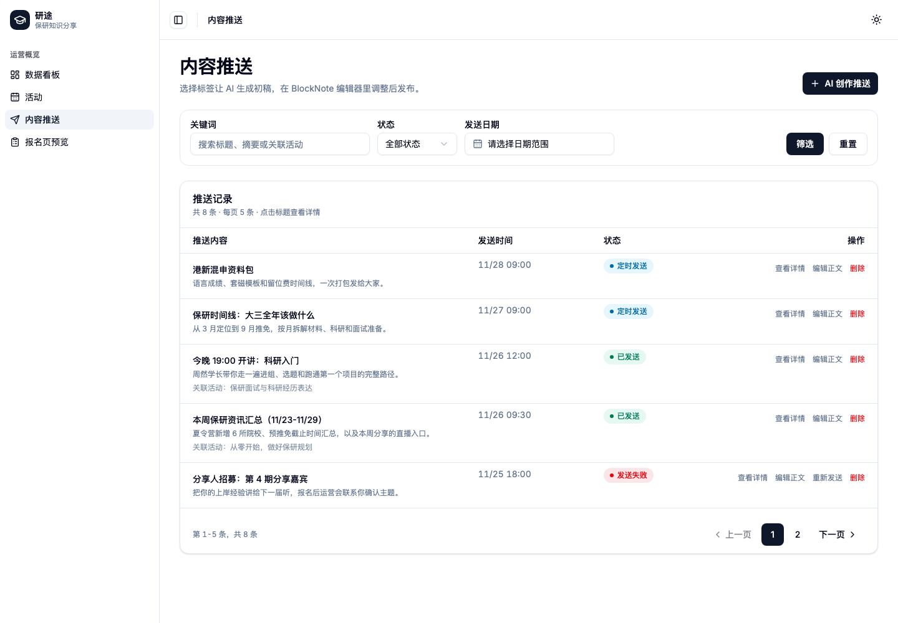
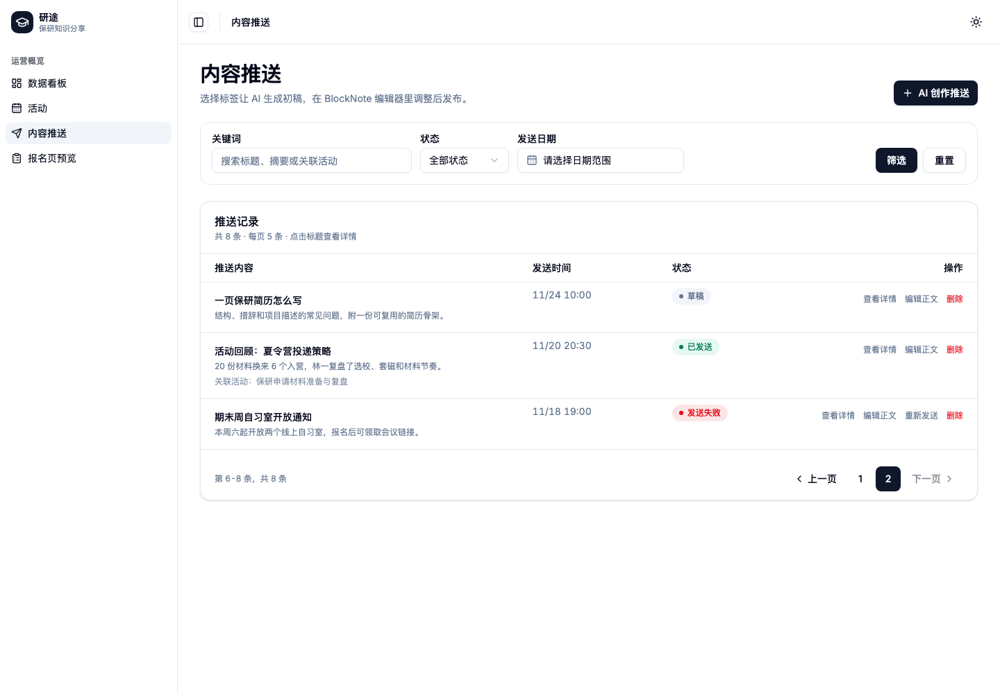
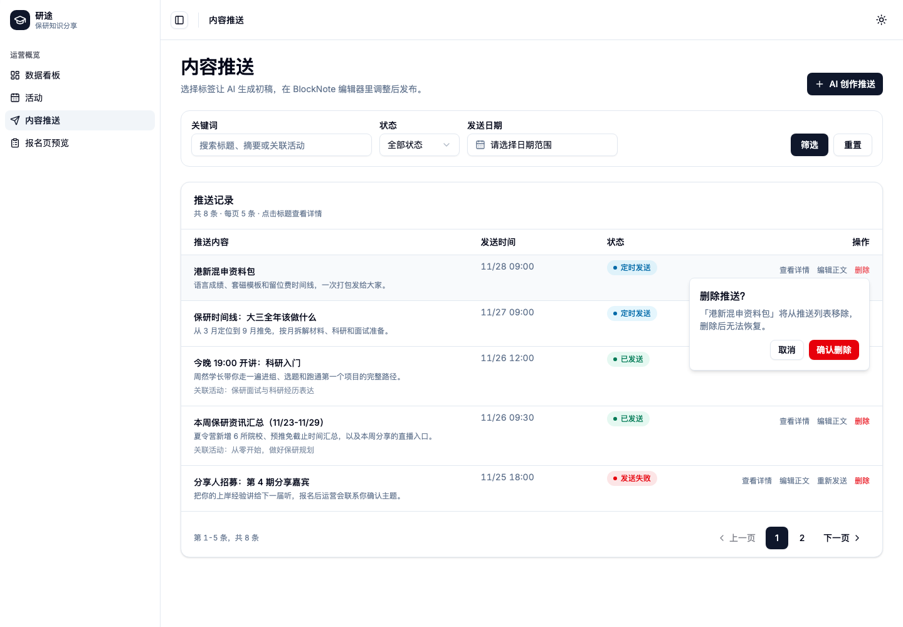
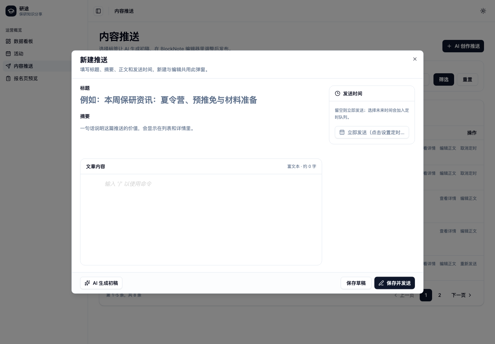
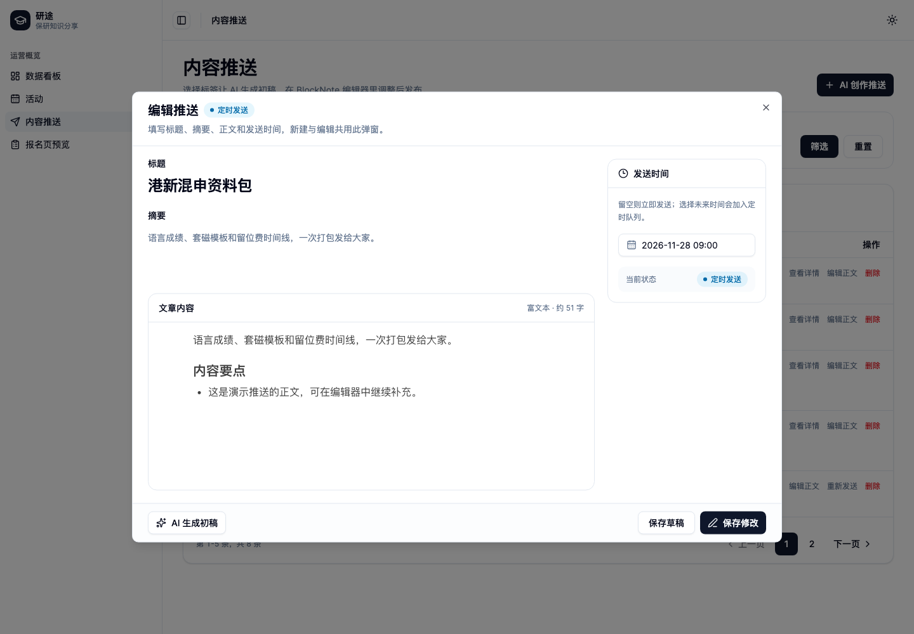
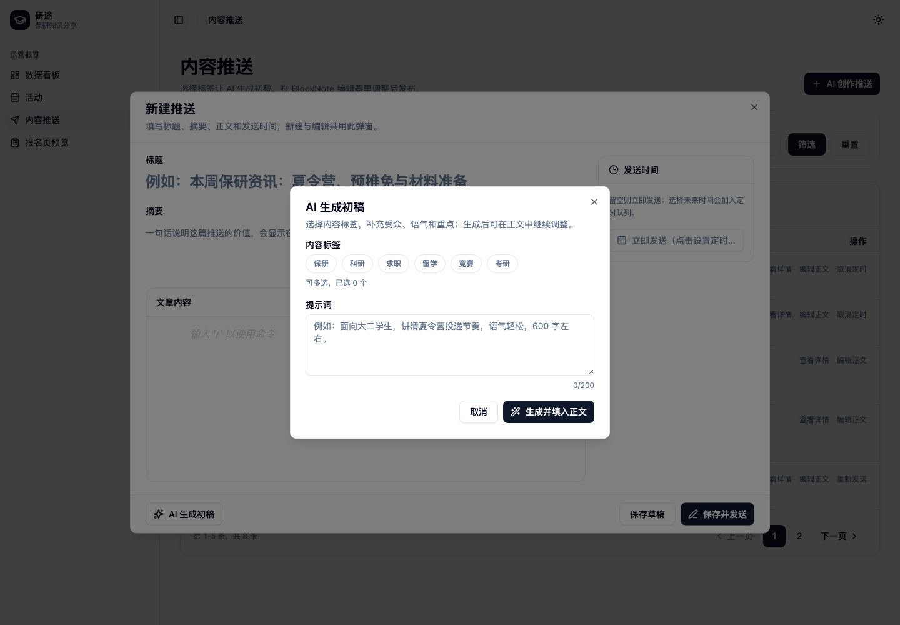
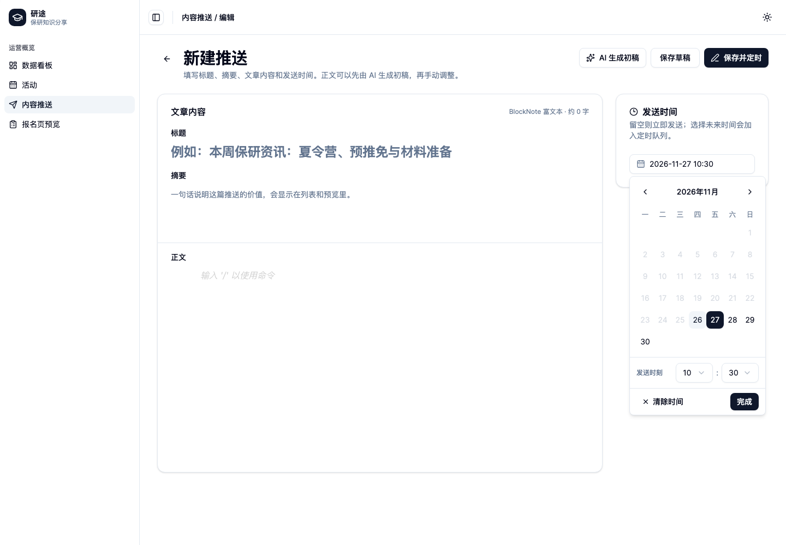

# 内容推送页设计（AI 创作 + BlockNote）

路由：`/content-push`（apps/web 运营后台）。列表用于查看和筛选推送记录；新建和编辑共用同一个弹窗，弹窗内只保留四个输入：**标题、摘要、文章内容、发送时间**。



列表默认每页 5 条，底部使用 shadcn `Pagination` 组件展示上一页、页码、下一页和当前范围。



删除操作同样使用文字按钮，点击后浮层二次确认；确认后从列表和本地存储中移除。



新建/编辑共用弹窗：正文使用 BlockNote 富文本，可先由 AI 生成初稿，再二次调整。





AI 生成入口是编辑弹窗内的二级弹窗，标题（与主表单同步）、标签和提示词放在弹窗里，不占用主表单字段。



发送时间使用日期时间选择组件：日历选日期、时/分下拉，可一键清除为立即发送。



## 1. 页面结构

```
内容推送
├── 筛选：关键词 / 状态 / 发送日期
├── 推送记录表：内容 / 发送时间 / 状态 / 操作
├── 分页：每页 5 条，上一页 / 页码 / 下一页
└── 新建 / 编辑共用弹窗
    ├── 标题
    ├── 摘要
    ├── 正文（BlockNote）
    ├── 发送时间
    └── AI 生成初稿弹窗（标题 + 标签 + 提示词）
```

桌面端编辑弹窗为「正文 + 发送时间」两栏，窄屏自动堆叠；弹窗头部和底部固定，中间内容区可滚动。

## 2. 功能明细

| 模块    | 能力                                       | 说明                                                                                |
| ------- | ------------------------------------------ | ----------------------------------------------------------------------------------- |
| 列表    | 关键词/状态/日期筛选、分页、编辑正文、删除 | 操作文字平铺：编辑正文 / 删除；失败行加「重新发送」；删除前浮层二次确认             |
| 新建    | 标题、摘要、正文、发送时间                 | 与编辑共用同一个弹窗；也可直接手写正文，不强制使用 AI                               |
| AI 生成 | 标题（与主表单同步）、多选标签、提示词     | 标题已填时保留原标题，围绕标题生成摘要和正文；标题留空时自动拟题                    |
| 正文    | BlockNote 富文本，带固定格式工具栏         | 支持正文/标题/列表、加粗/斜体/下划线/删除线、链接、撤销重做；JSON 保存并可二次编辑  |
| 发送    | 发送时间留空立即发送；未来时间进入定时队列 | 日期时间组件选日期和时分；顶部提供「保存草稿」「保存并发送/保存并定时」「保存修改」 |

### 字段约束

- 标题：必填，最长 60 字。
- 摘要：选填，最长 200 字；为空时自动截取正文前 86 字。
- 正文：必填，BlockNote 文档不能为空。
- 发送时间：选填；留空表示立即发送，未来时间表示定时发送；新建时不允许填写过去时间。

## 3. 状态与规则

| 状态                 | 含义             |
| -------------------- | ---------------- |
| `sent` 已发送        | 已发送           |
| `scheduled` 定时发送 | 已排期，尚未发出 |
| `failed` 发送失败    | 发送失败，可重试 |
| `draft` 草稿         | 未排期内容       |

- 新建 + 保存草稿 → `draft`。
- 新建 + 发送时间为空 → `sent`，发送时间取当前北京时间。
- 新建 + 未来发送时间 → `scheduled`。
- 编辑已有内容 → 默认保留原状态；填写未来发送时间会转为 `scheduled`。
- 页面不提供渠道、关联活动、触达和打开率输入或展示。
- 数据保存在 `localStorage`（`knowledge-share:content-push-v1`），刷新后保留；不真正发送。

## 4. 数据模型

```ts
type PushStatus = 'sent' | 'scheduled' | 'failed' | 'draft'

interface PushRecord {
  id: string
  title: string
  summary: string
  date: string // 北京时间 YYYY-MM-DD
  time: string // HH:mm
  status: PushStatus
  activity?: string
  document?: PartialBlock[] // BlockNote 文档 JSON
  tags?: string[] // AI 生成标签
  prompt?: string // AI 提示词
  aiGenerated?: boolean
}
```

老记录没有 `document` 时，读取时用摘要生成一个简短的 BlockNote 文档，保证仍可进入编辑器；不会覆盖原始记录。

## 5. AI 生成

当前为前端演示实现：`apps/web/src/features/content-push/push-ai.ts` 结合当前标题、标签和提示词拼装结构化文章，延迟约 1.2 秒模拟生成，输出：

```ts
interface GeneratedPush {
  title: string
  summary: string
  blocks: PartialBlock[] // 直接交给 BlockNote
}
```

接入真实 LLM 时保持这个出参结构即可，编辑器侧不需要改动。建议后端契约：

```
POST /pushes/generate
body: { tags: string[], prompt: string }
response: Result<{ title, summary, blocks }>
```

## 6. 后续接口契约

```
GET  /pushes?keyword=&status=&startDate=&endDate=&page=1&pageSize=20
POST /pushes                         // body: title/summary/document/tags/prompt/scheduledAt/activityId
GET  /pushes/:id
POST /pushes/:id/retry
DELETE /pushes/:id
POST /pushes/generate                // AI 生成初稿
```

返回统一使用后端 `Result`：`{ code: 200, msg: 'success', data }`。

## 7. 待确认

- AI 生成接哪个模型/Provider，是否需要流式输出和失败重试。
- 标签体系是否固定为保研/科研/求职/留学/竞赛/考研，是否允许自定义标签。
- BlockNote 文档版本兼容策略，以及历史内容迁移方式。
- 定时发送的最小提前量和时区口径。

## 8. 验收清单

- [x] 列表不展示统计卡，页面从标题直接进入筛选和记录表。
- [x] 新建与编辑共用同一个弹窗；弹窗只有标题、摘要、文章内容、发送时间四个输入，渠道、触达/打开、关联活动、标签面板不展示。
- [x] AI 弹窗标题可编辑且与主表单实时同步，结合标题、多选标签和提示词生成摘要和 BlockNote 正文；标题已填时保留原标题，留空时自动拟题。
- [x] 生成正文约 300 字，BlockNote 可继续输入、修改。
- [x] 保存草稿后重新打开，标题和正文内容完整保留。
- [x] 发送时间使用日期时间组件，支持日历、时/分选择和清除；留空可立即发送，未来时间进入定时队列，过去时间被拦截。
- [x] 列表操作全部以文字平铺展示：编辑正文 / 删除；发送失败行加「重新发送」；不再提供「复制内容」「取消定时」和查看详情入口。
- [x] 删除操作使用浮层二次确认，确认后从列表和本地存储中移除。
- [x] 新建和编辑复用同一个 BlockNote 编辑弹窗，AI 生成初稿作为二级弹窗打开。
- [x] 列表按每页 5 条分页，上一页/页码/下一页可切换，筛选或新增后回到第 1 页。
- [x] 页面本身无横向溢出；窄屏下列表在卡片内横向滚动，操作按钮保持可见，编辑区和发送时间卡正常堆叠。
- [x] 移动端编辑弹窗在视口内，不产生页面横向溢出。
- [x] `pnpm --filter @knowledge-share/web typecheck`、ESLint、生产构建通过。
