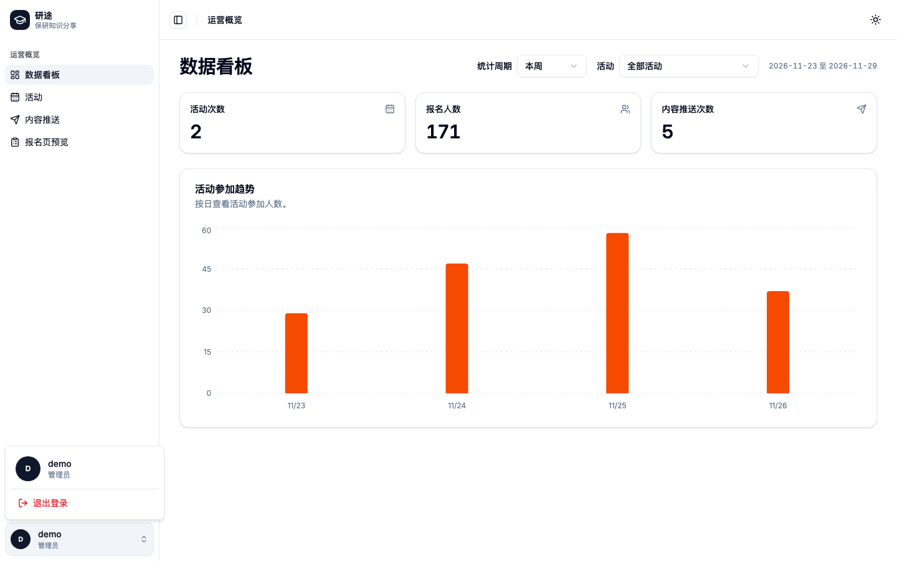
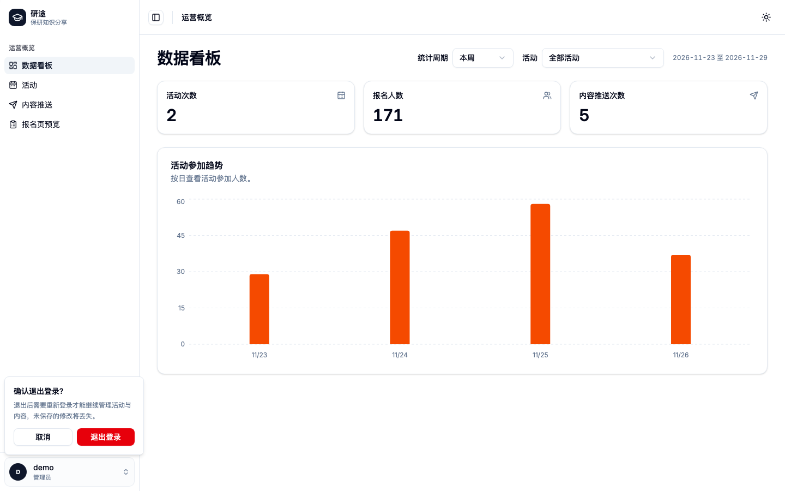
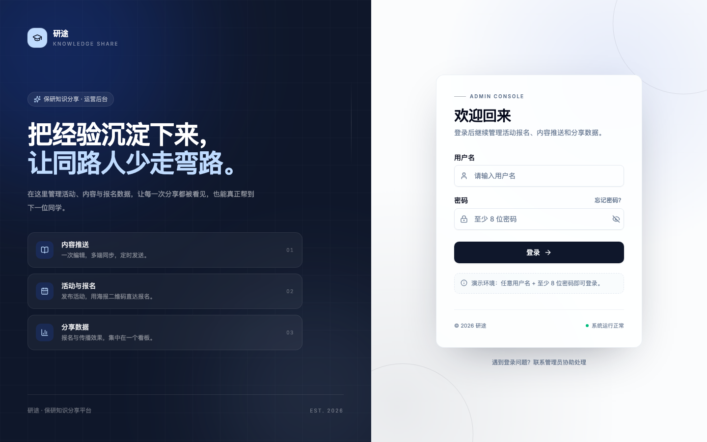
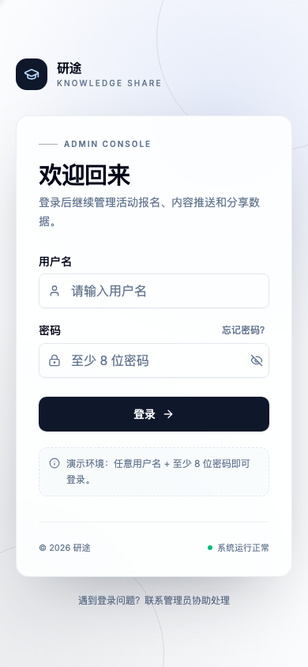

# 登录页设计

登录页路由为 `/sign-in`，沿用现有 TanStack Router 的 `redirect` 参数：登录成功后回到来源页面，没有来源时进入 `/`。

## 页面结构

- **左侧品牌区**：深色底、细网格与蓝色光晕，承载「研途 / Knowledge Share」品牌、主标语和三项能力介绍（内容推送、活动与报名、分享数据）。桌面端展示，移动端隐藏。
- **右侧登录区**：浅色底与柔和径向光晕，登录卡片居中；移动端顶部显示简化品牌标识。
- **登录卡片**：包含「ADMIN CONSOLE / 欢迎回来」、用户名与密码字段、忘记密码入口、登录按钮、演示提示和底部系统状态。

## 表单与交互

- 字段：`用户名`、`密码`。
- 校验：用户名 2–30 位，只允许字母、数字、下划线和短横线，不允许空格；密码必填且至少 8 位。错误文案为中文。
- 登录：提交用户名和密码给后端。认证成功后在本地保存用户资料与 JWT，并按站内 `redirect` 参数跳转。
- 忘记密码：点击后提示“请联系管理员重置密码”。
- 演示提示：明确说明任意用户名 + 至少 8 位密码即可登录。

## 视觉与适配

- 配色沿用项目主色：深海军蓝 `#0f172a`、浅蓝 `#bfdbfe`、蓝 `#1d4ed8`，右侧使用主题的 `background`、`card`、`muted` 变量。
- 桌面端采用左右分栏，左侧品牌区高度铺满视口；右侧登录卡片宽 420px。
- 移动端收起品牌区，保留品牌标识与登录卡片；390px 宽度下无横向溢出。
- 暗色模式复用主题变量，卡片、输入框和文字自动切换，不需要单独维护暗色样式。

## 登录态与退出

- 登录后，后台侧栏左下角展示当前用户名和角色，折叠侧栏时只展示头像首字。
- 点击用户区域弹出账号 popover，展示头像、用户名、角色和「退出登录」。
- 点击「退出登录」后，同一 popover 内切换为二次确认视图，说明未保存修改会丢失；取消后回到账号信息，仍停留在当前页面。
- 确认退出后清除登录态与 token，关闭移动端侧栏并跳转 `/sign-in`。
- 演示账号直接使用输入的用户名；用户名不能重复由后端唯一索引保证。

## 截图

## 实现位置

- `apps/web/src/features/auth/auth-layout.tsx`：品牌区、背景与响应式布局。
- `apps/web/src/features/auth/sign-in/index.tsx`：登录卡片结构与页脚。
- `apps/web/src/features/auth/sign-in/components/user-auth-form.tsx`：表单、校验、登录接口与登录状态。
- `apps/web/src/components/layout/operations-layout.tsx`：侧栏底部用户入口、账号 popover 和退出登录二次确认。
- `apps/web/src/routes/(auth)/sign-in.tsx`：路由与 `redirect` 查询参数。

## 验收

- [x] 桌面端左右分栏，品牌区与登录区视觉层级清晰。
- [x] 390px 移动端无横向溢出，登录卡片完整展示。
- [x] 空表单提交展示中文校验文案。
- [x] 输入合法用户名与 8 位以上密码可登录，并跳转 `/` 或 `redirect` 指定路径。
- [x] 暗色模式下页面可正常阅读。
- [x] 侧栏左下角展示用户名，点击弹出账号 popover；退出登录在同一点层内二次确认，取消不退出，确认后跳转登录页。

## 待接入

超级管理员在「系统管理 → 用户管理」生成邀请链接。受邀者通过链接设置用户名和密码，创建普通管理员账号后返回登录页。
